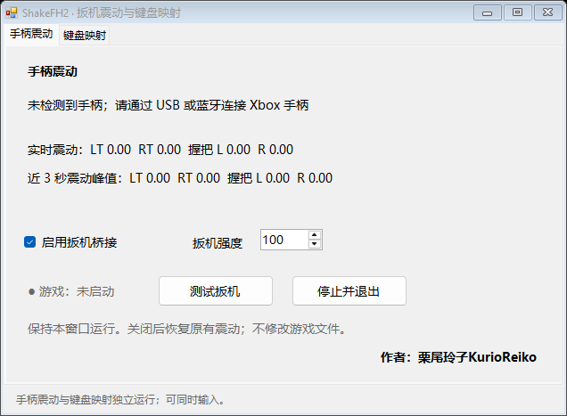
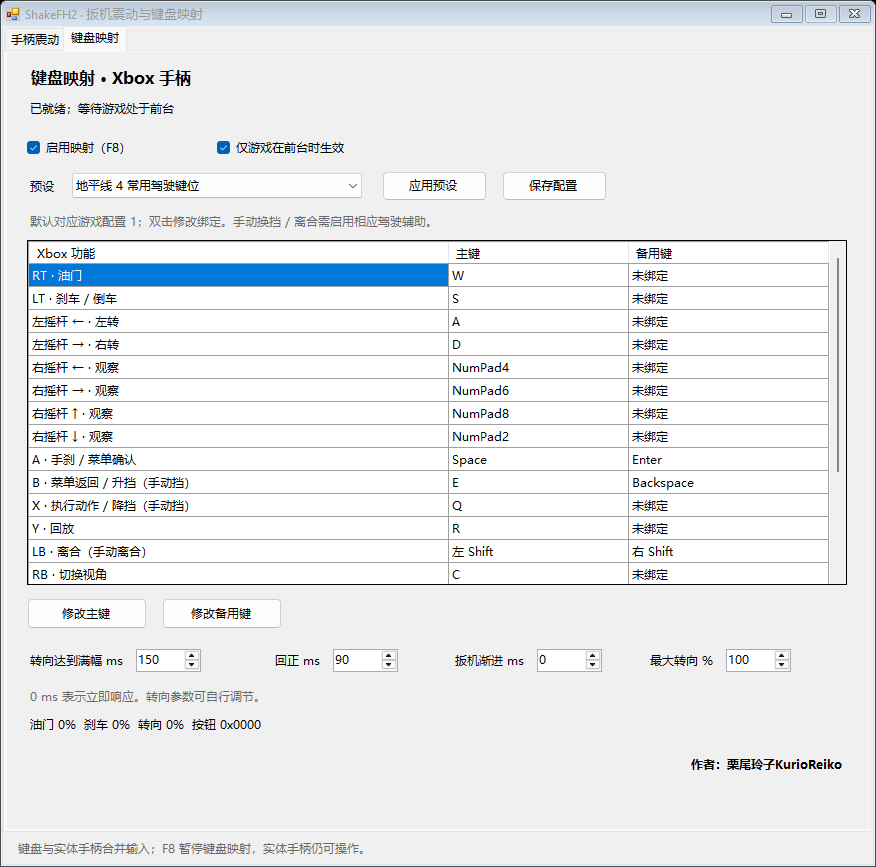

# ShakeFH2

**扳机震动 + 键盘映射，一个软件，两个界面。**

为 Azimuth 上的 Xbox One 版《地平线 2》及《地平线 2：速度与激情》（常称“速度与激情 DLC”）提供原生扳机震动和键盘操作，支持**实体手柄与键盘同时输入**。

作者：**栗尾玲子KurioReiko**

## 下载

从 [Releases](https://github.com/Kur1oR3iko/ShakeFH2/releases/latest) 下载 **v2.0.0 Windows x64**，解压后运行 ShakeFH2.exe。

分发包只有三个文件：ShakeFH2.exe、XboxTriggerOutput.dll 和简要 README.md。EXE 与 DLL 必须放在同一目录。

## 两个界面

### 手柄震动

- 转发游戏原本生成的左右握把、左右扳机四路震动。
- 支持 Xbox 手柄通过 **USB 或蓝牙**连接。
- 可调节扳机强度，默认 100%，握把保留游戏原始强度。
- 显示实时值和近 3 秒峰值，方便观察短脉冲。
- 自动排除键盘映射的虚拟设备，震动发给实体手柄。
- 停止接管时清零；游戏切到后台时暂停震动。

数值表示**马达震动强度，不是扳机按下的深度**。

### 键盘映射

- 默认驾驶键位参考 FH4，功能标注依据 FH2 控制配置 1。
- 提供默认、方向键驾驶和空白预设。
- 每项可设置主键、备用键，配置自动保存。
- 可调转向渐进、回正、扳机渐进和最大转向幅度。
- F8 暂停 / 恢复键盘映射，实体手柄仍可操作。
- 默认只在游戏前台发送键盘输入，切出游戏立即释放。
- 默认不显示与当前游戏功能无关的字段。

**切换标签页只切换界面，不会停用另一个功能。** 不需要为了使用键盘而断开实体手柄。

## 手柄与键盘同时操作

软件在游戏实际读取的输入通道中合并两种输入：

| 输入 | 合并规则 |
| --- | --- |
| 按钮 | 两种来源的按钮合并 |
| 油门 / 刹车 | 取两种来源中较大的值 |
| 摇杆 | 键盘轴非零时优先使用键盘，回正后使用手柄值 |

当前合并第一台可用实体手柄与键盘；震动直接发送给实体手柄。

## 适用版本与要求

| 项目 | 适用环境 |
| --- | --- |
| 运行器 | **Azimuth 0.9.7，Windows x64** |
| 游戏 | **Xbox One 版《地平线 2》（Anthem 1.0.0.64）及《地平线 2：速度与激情》** |
| 系统 | Windows x64、.NET Framework 4.x；实测 Windows 11 |
| 手柄 | Xbox 手柄 |
| 键盘驱动 | ViGEmBus；实测 1.21.442.0 |

**新版本运行器、游戏及其他构建不保证支持。** 震动捕获和输入合并依赖运行器接口，更新后可能改变这些接口。

键盘功能需要已经安装 [ViGEmBus](https://github.com/nefarius/ViGEmBus/releases)。软件不会自动安装驱动。客户端已内置，最终用户不需要安装 Python、Zig 或额外分发客户端 DLL。

扳机震动需要手柄有对应马达。不适用于 Xbox 360 版《地平线 2》，也不是其他 Forza 游戏的通用插件。

## 使用

1. 退出旧版 ShakeFH2 / KeyFH2。升级前先退出游戏，解压新版到独立文件夹。
2. 保留旧键位时，将旧目录的 KeyFH2.ini 复制到新版目录。
3. 启动 ShakeFH2.exe，连接手柄，按原有方式启动游戏。
4. 在两页分别设置功能；两个功能可独立启用。
5. 关闭软件会释放键盘输入、移除虚拟手柄并停止震动接管。

通常不需要管理员权限；游戏以管理员身份运行时，软件需要同等权限。

软件只有一个操作窗口。任务管理器可能显示一个额外的同名隐藏进程，用于隔离键盘输入后端。内置客户端首次使用时解包到当前用户的本地应用数据目录。

## 默认键位

| 键盘 | 功能 |
| --- | --- |
| W / S | 油门 / 刹车、倒车 |
| A / D | 转向 |
| Space / Enter | 手刹 / 菜单确认 |
| E / Backspace | 手动挡升挡 / 菜单返回 |
| Q | 执行动作；手动挡降挡 |
| Shift | 手动离合 |
| R / C / M / Esc | 回放 / 视角 / 地图 / 暂停 |
| 方向键 | 菜单导航；驾驶中对应相片、遥测、广播、排行榜 |
| 小键盘 4 / 6 / 8 / 2 | 右摇杆观察 |

双击表格键位可修改或清除。当前每个绑定为单个键，不支持组合键；F8 保留给暂停 / 恢复。

## 实现与验证

通过运行中的内存接口捕获震动、合并输入，不改写游戏文件或存档。输出模块在游戏进程内执行，键盘后端隔离运行，避免接口相互影响。

已在实际游戏中确认：**两种输入均可操作，切换页面后震动正常**。自动测试涵盖内存桥接、真实 XInput 回读、配置迁移、双后端生命周期和原生合并规则，见 [VALIDATION.md](VALIDATION.md)。

没有与 Xbox 主机做同步波形和延迟比较，不保证触感和时序完全相同。键盘转向是可调摇杆渐进，没有复制 FH4 的速度相关算法。

## 编译

需要 Windows x64、.NET Framework 4.x C# 编译器和 **Zig 0.16.0**。

    .\build.ps1 -ZigPath 'C:\tools\zig\zig.exe'

脚本从官方 NuGet 获取 Nefarius.ViGEm.Client 1.21.256，校验 x64 客户端哈希并嵌入 EXE。成品输出到 dist/ShakeFH2，仅分发上方列出的三个文件，调试产物不分发。

关闭游戏后可以执行：

    & .\dist\ShakeFH2\ShakeFH2.exe --self-test | Out-String
    & .\dist\ShakeFH2\ShakeFH2.exe --test-modes | Out-String
    & .\dist\ShakeFH2\ShakeFH2.exe --test-mixing | Out-String

## 参考与许可

Azimuth 震动函数特征和四路 float 布局参考 [FH2-DualSense](https://github.com/aminenrr/FH2-DualSense)。虚拟手柄客户端使用 [ViGEmClient](https://github.com/nefarius/ViGEmClient)。第三方许可见 [THIRD-PARTY-NOTICES.txt](THIRD-PARTY-NOTICES.txt)。

不包含游戏、运行器、DLC 或驱动安装器，与 Microsoft、Playground Games 或 Azimuth 开发者没有官方关联。
